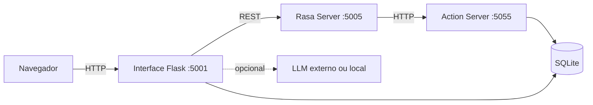

# 📖 Introdução ao Assistente de Atividades

> **Versão 2 do projeto** · documento revisado em 16 nov. 2026 e conferido contra o código. O que não foi testado está dito no texto.

## O que é este projeto

Um chatbot em português, feito com Rasa Open Source 3.6.21, que:

- registra atividades de bem-estar numa frase (`bebi água`, `corri 30 minutos intenso`);
- conduz um formulário quando o usuário prefere ser guiado;
- agenda atividades (`agendar yoga amanhã às 7h`) e dá baixa quando elas são registradas;
- informa o progresso de hoje e dos últimos 7 dias;
- mostra, a cada mensagem, o que aconteceu dentro do Rasa (tela **Raio-X**).

Ele existe para ensinar. Cada conceito da aula — intenção, entidade, slot, política, ação — aparece na tela no momento em que acontece.

## Para quem é

Estudantes de pós-graduação em IA que estão vendo chatbots pela primeira vez. Basta saber ler Python e YAML. Não é preciso experiência com aprendizado de máquina.

## O que você vai aprender

| Tema | Onde aparece no projeto |
|---|---|
| Como um classificador de intenção decide | Barras de confiança do Raio-X |
| Por que ele erra com confiança alta | `tomei um café` |
| O papel das regras ao lado do aprendizado de máquina | `malhei 1 hora` vira `musculação · 60 min` |
| Como manter um chatbot | Mural “Quebre o bot” e a correção ao vivo de `bebi h2o` |
| O que um teste prova e o que não prova | `python run.py test` e a prova com frases inéditas |
| Classificador treinado × LLM instruído | Tela Duelo 1.0 × 2.0 |

## Funcionalidades

| Tela | Endereço | Para que serve |
|---|---|---|
| Chat + Raio-X | `/` | Conversar e ver as seis etapas do processamento |
| Quebre o bot | `/mural` | Falhas percebidas pelo sistema ou reportadas pela turma |
| Duelo 1.0 × 2.0 | `/duelo` | A mesma frase no classificador e num LLM (opcional, com chave) |
| Replay | `/replay` | Conversa gravada; funciona sem o Rasa |
| Dashboard | `/dashboard` | Totais, sequência de dias, agenda, exportação CSV |
| Saúde | `/saude` | O que está no ar |

Telas reais: [assets/screenshots/](assets/screenshots/INSTRUCOES-SCREENSHOTS.md).

## Arquitetura em uma figura

São três processos. A interface fala com o Rasa por HTTP; o Rasa chama o Action Server quando precisa executar código Python; as ações gravam no SQLite. A interface lê o mesmo banco para o painel e o mural.

## Limites que convém saber desde já

- O Rasa Open Source está em modo de manutenção; o desenvolvimento do fabricante segue no CALM, que é licenciado.
- Testado apenas em Linux.
- Três falhas foram mantidas de propósito, para a aula: `tomei um café`, `bebi h2o` e `valeu, fui`.
- A agenda não envia notificações: o lembrete aparece quando você fala com o bot.

## Próximos passos

[INICIO-RAPIDO.md](INICIO-RAPIDO.md) para rodar; [02-conceitos-rasa.md](02-conceitos-rasa.md) para os conceitos.
