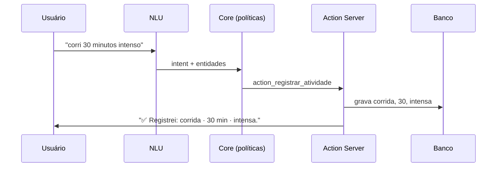

# 🧠 Conceitos básicos do Rasa Open Source

> **Versão 2 do projeto** · documento revisado em 16 nov. 2026 e conferido contra o código. O que não foi testado está dito no texto.

## O que é o Rasa

Um framework de código aberto (licença Apache 2.0) para chatbots que separa duas tarefas: **entender** a mensagem (NLU, “Natural Language Understanding”, compreensão de linguagem natural) e **decidir** o que fazer (Core, o gerenciamento do diálogo). Você ensina as duas com exemplos e regras escritos em YAML.

## As peças

| Conceito | O que é | No projeto |
|---|---|---|
| **Intent** (intenção) | O que o usuário quer | `registrar_atividade_rapido`, `ask_agenda` |
| **Entity** (entidade) | Um dado dentro da frase | `tipo_atividade`, `duracao`, `intensidade` |
| **Slot** | Memória da conversa | Os mesmos três nomes, preenchidos pelas entidades |
| **Response** (resposta) | Texto pronto | `utter_ajuda`, `utter_stop` |
| **Action** (ação) | Código Python | `action_registrar_atividade` |
| **Form** (formulário) | Coleta guiada de slots | `atividade_detalhada_form` |
| **Rule** (regra) | “Se isto, então aquilo”, sempre | “Cancelar formulário ativo” |
| **Story** (história) | Exemplo de conversa para o modelo aprender | `agenda_e_baixa` |
| **Policy** (política) | Quem escolhe a próxima ação | RulePolicy, MemoizationPolicy, TEDPolicy |
| **Tracker** | Histórico estruturado da conversa | É dele que o Raio-X lê os dados |

## O caminho de uma mensagem

Saída real do NLU para essa frase, medida em laboratório: intent `registrar_atividade_rapido` com confiança 1,00; entidades `tipo_atividade = corrida`, `duracao = 30`, `intensidade = intenso`. O banco grava `intensa`: quem normaliza é uma regra em Python, não o modelo.

## Analogia: o Rasa como uma lanchonete

- O **atendente** (NLU) ouve o pedido e anota: “quer um lanche” (intent), “de frango, sem cebola” (entidades).
- A **comanda** (slots) guarda o que já foi dito.
- O **gerente** (políticas) decide o próximo passo: perguntar a bebida, mandar para a cozinha, chamar o caixa.
- A **cozinha** (Action Server) faz o trabalho de verdade.
- O **cardápio** é fechado: peça algo fora dele e o atendente anota o item mais parecido, com toda a segurança. É o que acontece com `tomei um café`.

## Duas ideias que evitam muita confusão

1. **Confiança alta não é acerto.** O classificador reparte 100% entre as intenções que conhece. Ele não tem a opção “nenhuma delas”, a menos que haja exemplos de fora de escopo parecidos com a frase.
2. **Sinônimo não ensina palavra nova.** O mapeador de sinônimos só troca o valor de uma entidade que o modelo já extraiu. Se o modelo nunca viu `h2o` marcado como entidade, o sinônimo `h2o → água` não é acionado.

## Glossário curto

- **Pipeline**: sequência de componentes do NLU (tokenizador, featurizadores, classificador).
- **Featurizador**: transforma texto em números. No projeto, contagens esparsas de palavras e de pedaços de palavras.
- **DIET**: o modelo que classifica a intenção e extrai entidades ao mesmo tempo.
- **Fallback**: resposta de contingência quando a confiança fica abaixo do limiar (0,5 no projeto).
- **CALM**: abordagem mais nova do fabricante, em que um LLM interpreta a conversa e fluxos determinísticos executam. Não é de código aberto.

Glossário completo: [tutorial/apendice-b-glossario.md](tutorial/apendice-b-glossario.md).

## Próximos passos

[06-arquitetura-rasa.md](06-arquitetura-rasa.md) aprofunda cada peça com o código do projeto.
