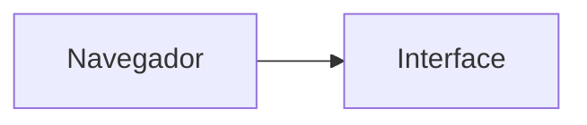

# ✅ Como usar os diagramas Mermaid

> **Versão 2 do projeto** · documento revisado em 16 nov. 2026 e conferido contra o código. O que não foi testado está dito no texto.

Mermaid é uma linguagem de texto para diagramas. O arquivo `.mmd` é o diagrama; não há imagem para manter em paralelo.

## Três jeitos de ver

1. **No GitHub ou GitLab**: um bloco de código marcado como `mermaid` dentro de um arquivo Markdown é desenhado na página.
2. **No editor**: VS Code e similares têm extensões de pré-visualização de Mermaid.
3. **No editor online** do projeto Mermaid (<https://mermaid.live>): cole o conteúdo do arquivo. Não cole nada confidencial em serviço online.

## Colocar um diagrama num documento

Copie o conteúdo do `.mmd` para um bloco:

````markdown

````

Os guias desta pasta já fazem isso, por exemplo em [01-introducao.md](../../01-introducao.md).

## Gerar imagem

Com o Node.js instalado, a ferramenta de linha de comando do Mermaid converte para PNG ou SVG:

```bash
npx -p @mermaid-js/mermaid-cli mmdc -i arquitetura-geral.mmd -o arquitetura-geral.png
```

## Regras de escrita que evitam erro

- Texto com parênteses, dois-pontos ou acentos fica entre aspas: `A["Rasa (5005)"]`.
- Quebra de linha dentro de um nó: `<br/>`.
- Um arquivo, um diagrama.
