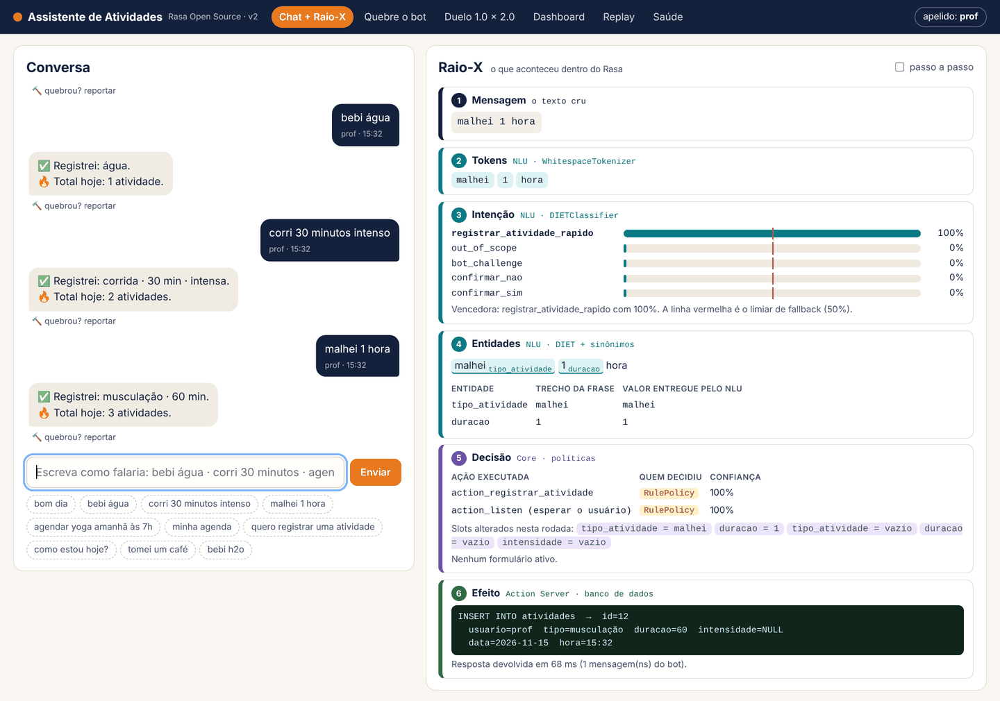

# 📸 Telas do sistema

> **Versão 2 do projeto** · documento revisado em 16 nov. 2026 e conferido contra o código. O que não foi testado está dito no texto.

## Telas incluídas

Capturadas do sistema em execução no laboratório (Linux, Python 3.10.20), em 15 nov. 2026, com navegador em modo automático. As imagens foram reduzidas para 1440 pixels de largura.

| Arquivo | O que mostra |
|---|---|
| `tela_raiox_malhei.png` | Chat e Raio-X de `malhei 1 hora`: NLU entrega `malhei / 1`, banco grava `musculação / 60` |
| `tela_raiox_agendar.png` | Raio-X de `agendar yoga amanhã às 7h` |
| `tela_raiox_cafe.png` | A falha `tomei um café`: confiança alta, nenhuma entidade |
| `tela_raiox_passo_a_passo.png` | Raio-X em modo passo a passo |
| `tela_mural.png` | Mural “Quebre o bot” |
| `tela_dashboard.png` | Painel de dados; há um só dia de dados, por isso uma barra |
| `tela_duelo_sem_llm.png` | Duelo com o lado do LLM desligado (o laboratório não tinha chave) |
| `tela_replay.png` | Tela Replay, com a faixa que identifica a gravação |
| `tela_saude.png` | Situação dos serviços |

## Como capturar as suas

1. `python run.py limpar-banco --sim` e `python run.py start`.
2. Percorra o roteiro de [03-execucao-testes.md](../../03-execucao-testes.md) com um apelido de demonstração.
3. Capture com a ferramenta do sistema: no macOS, Shift+Command+4; no Windows, Win+Shift+S; no Linux, a tecla Print Screen ou a ferramenta do seu ambiente.
4. Use zoom do navegador em 125% ou mais: o Raio-X precisa ficar legível.

## Cuidados

- Não capture o arquivo `.env` nem o terminal com chaves à vista.
- Use apelidos fictícios. Frases e apelidos de alunos são dados pessoais.
- Se a tela vier do Replay, deixe a faixa amarela aparecer: ela diz que é gravação.
- Nomeie no padrão `tela_<o-que-mostra>.png`.
