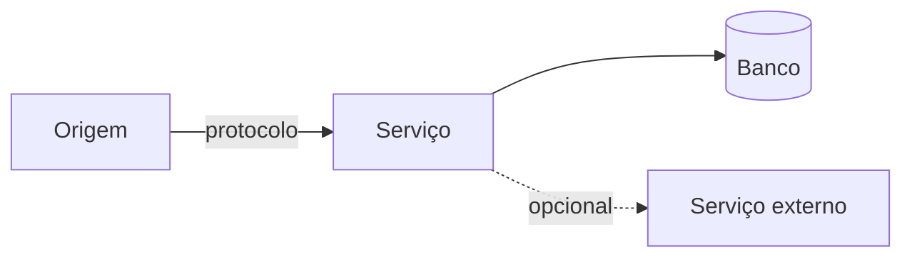
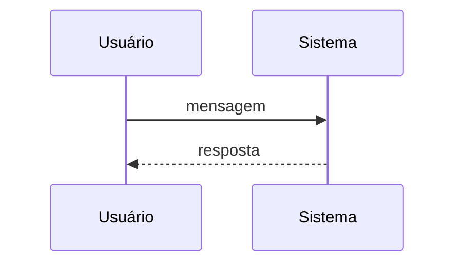
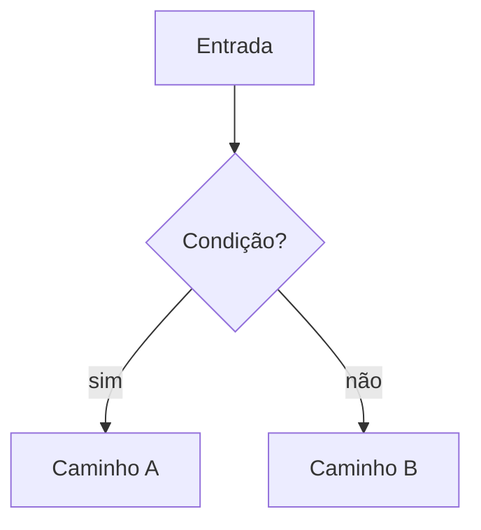
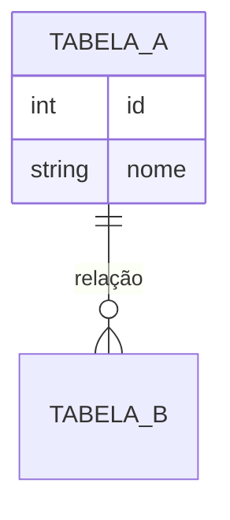

# 🎨 Modelos de diagrama

> **Versão 2 do projeto** · documento revisado em 16 nov. 2026 e conferido contra o código. O que não foi testado está dito no texto.

Modelos em Mermaid para novos documentos. Copie, troque os nomes e confira o resultado em um visualizador (veja [USAR-MERMAID-DIRETO.md](../diagramas/USAR-MERMAID-DIRETO.md)).

## Fluxo de componentes

## Sequência de uma mensagem

## Decisão

## Modelo de dados

## Boas práticas

- Um diagrama, uma ideia. Se precisa de legenda longa, divida.
- Nomeie as setas com o que trafega (HTTP, REST, SQL).
- Linha tracejada para o que é opcional.
- Diagrama descreve o código de hoje. Mudou o código, mude o diagrama.
