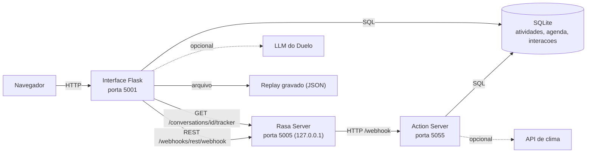
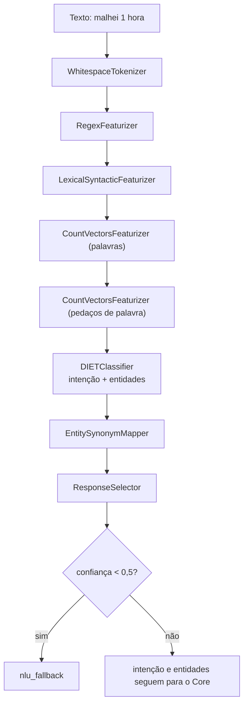
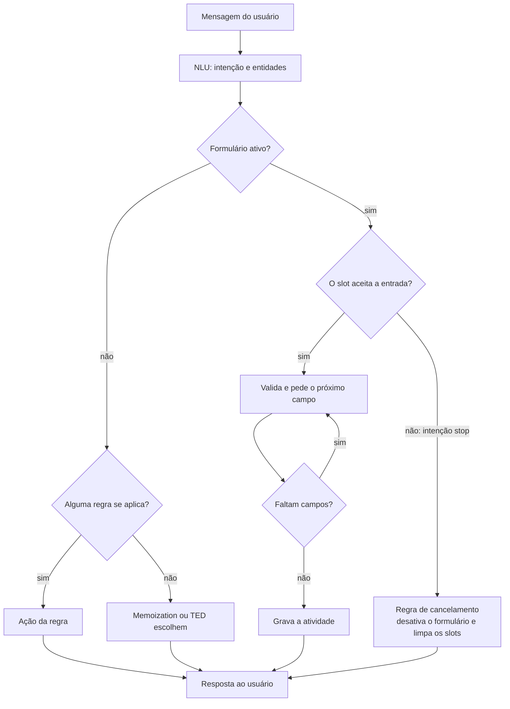
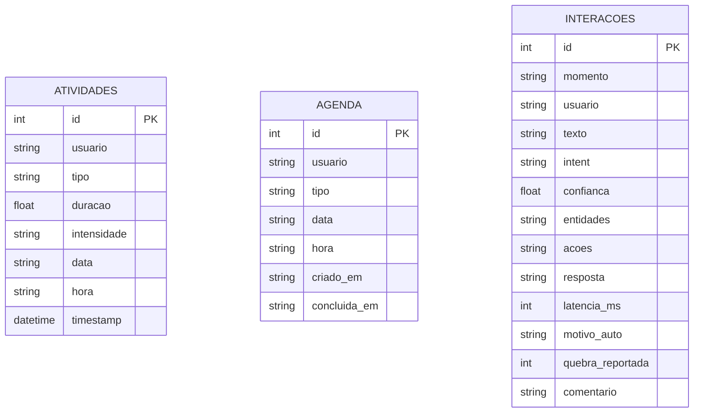
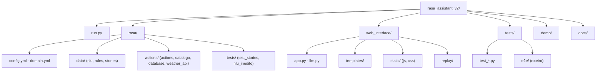

# 🗺️ Apêndice E: Diagramas

> **Versão 2 do projeto** · documento revisado em 16 nov. 2026 e conferido contra o código. O que não foi testado está dito no texto.

Os cinco diagramas do projeto, desenhados em Mermaid. Os arquivos-fonte estão em [../assets/diagramas/](../assets/diagramas/README.md). Em visualizadores sem suporte a Mermaid, aparece o texto do diagrama.

## Arquitetura geral

## Pipeline de NLU

## Fluxo de decisão da conversa

O ramo da esquerda é o que explica o cancelamento: o formulário só larga a conversa quando o slot recusa a entrada.

## Modelo de dados

## Estrutura de pastas

## Telas

As capturas reais do sistema estão em [../assets/screenshots/](../assets/screenshots/INSTRUCOES-SCREENSHOTS.md).
