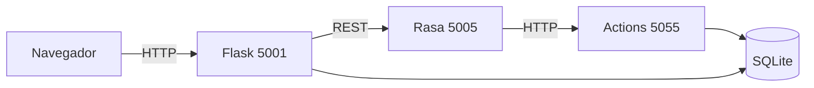

# 🏗️ Capítulo 3: Arquitetura completa

> **Versão 2 do projeto** · documento revisado em 16 nov. 2026 e conferido contra o código. O que não foi testado está dito no texto.

## Objetivos

Descrever os três processos do sistema e o caminho de uma mensagem entre eles.

## Três processos

| Processo | Porta | Responsabilidade |
|---|---|---|
| Interface Flask | 5001 | Páginas, API, Raio-X, mural, duelo |
| Rasa Server | 5005 | NLU e políticas |
| Action Server | 5055 | Código Python das ações |



Por que separar o Action Server? Porque o Rasa não executa o seu código dentro dele: pede a outro processo. Assim, mudar uma ação exige reiniciar só esse processo, e uma ação com erro não derruba o Rasa.

## O caminho de uma mensagem

1. O navegador envia `POST /api/chat` com a mensagem e o apelido.
2. A interface repassa ao Rasa pelo canal REST.
3. O NLU produz intenção e entidades.
4. As políticas escolhem a ação.
5. Se for ação customizada, o Rasa chama o Action Server.
6. A ação normaliza os valores, grava no SQLite e devolve o texto.
7. A interface busca o tracker da conversa, monta o Raio-X, registra a interação e responde.

O passo 7 é o que torna o sistema didático: o Raio-X não é desenhado à mão, é lido do Rasa.

```python
# web_interface/app.py
def motivo_automatico(raiox):
    """Sinais objetivos de que o bot pode ter falhado (viram itens do mural)."""
    if raiox is None:
        return None
    nomes = [a["nome"] for a in raiox["acoes"]]
    if raiox["intent"]["nome"] == "nlu_fallback" and not raiox["formulario_ativo"] \
            and "action_submit_atividade_form" not in nomes:
        return "o bot não entendeu (fallback)"
    if any("não identifiquei a atividade" in r for r in raiox["respostas"]):
        return "entendeu a intenção, mas não a atividade"
    confianca = raiox["intent"]["confianca"] or 0
    if raiox["intent"]["nome"] != "nlu_fallback" and confianca < LIMIAR_CONFIANCA:
        return "baixa confiança (%d%%)" % round(confianca * 100)
```

A função acima decide, com sinais objetivos, se uma interação deve ir para o mural de falhas.

## O que mudou da versão 1

| Versão 1 | Versão 2 |
|---|---|
| Comunicação por Socket.IO | Requisições HTTP simples |
| Bibliotecas carregadas da internet | Tudo local |
| Rasa escutando em todas as interfaces | Rasa só em 127.0.0.1 |
| Um banco sem dono | Registros por usuário |

## Onde ficam os dados

- **Atividades, agenda e interações**: SQLite, em `database/atividades.db`. Persistem.
- **Conversas (tracker)**: memória do Rasa. Somem ao reiniciar.
- **Modelo**: `rasa/models/chatbot-assistant-v2.tar.gz`.

## Exercícios

1. Se o Action Server cair, que tipo de mensagem ainda recebe resposta? (Pense nas respostas `utter_`.)
2. Por que a interface lê o banco diretamente, em vez de pedir ao Rasa?
3. Desenhe o caminho de `como estou hoje?`.

## Resumo

Três processos, um banco, um caminho de sete passos. Mais detalhes em [../06-arquitetura-rasa.md](../06-arquitetura-rasa.md).

---
[← Capítulo anterior](capitulo-02-conceitos.md) · [Índice do tutorial](../TUTORIAL_COMPLETO.md) · [Próximo capítulo →](capitulo-04-instalacao.md)
